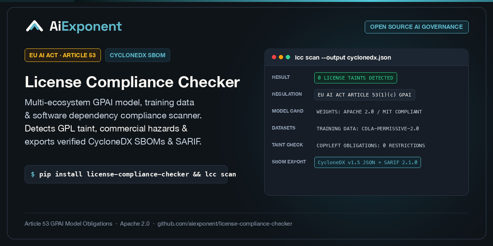
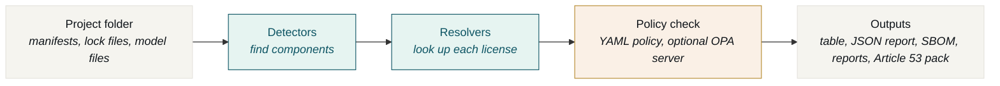

<div align="center">
  <picture>
    <source media="(prefers-color-scheme: dark)" srcset="https://raw.githubusercontent.com/aiexponent/license-compliance-checker/main/.github/brand/og-license-compliance-checker-dark.png">
    <source media="(prefers-color-scheme: light)" srcset="https://raw.githubusercontent.com/aiexponent/license-compliance-checker/main/.github/brand/og-license-compliance-checker-light.png">
    
  </picture>
  <h1 align="center">License Compliance Checker (LCC)</h1>
  <p align="center"><em>Know what you ship. Know what you owe.</em></p>
  <p align="center">
    <a href="https://pypi.org/project/license-compliance-checker/"></a>
    <a href="https://github.com/aiexponent/license-compliance-checker/actions"></a>
    <a href="https://aiexponent.github.io/license-compliance-checker/"></a>
    <a href="LICENSE"></a>
    <a href="https://www.python.org/downloads/"></a>
    <a href="https://eur-lex.europa.eu/legal-content/EN/TXT/?uri=CELEX:32024R1689"></a>
    <a href="#privacy"></a>
  </p>
</div>

---

> **License Compliance Checker (LCC) scans a project's dependencies for licenses, checks them against a policy, and writes CycloneDX and SPDX SBOMs. It can also write an EU AI Act Article 53 documentation pack for the AI models it finds. Apache 2.0, AS IS.**
>
> LCC is an engineering tool. It is **not** legal advice and it does not decide whether you meet any law. Its output is evidence for your own review.

Every command on this page was run on version 2.0.2 with Python 3.11.

---

## What it is for

Most projects ship code they did not write: packages, and now AI models and datasets. Each one comes with license terms. LCC answers one question from the command line or in CI:

> *Which licenses are in this project, and does any of them break our policy?*

Article 53 of the EU AI Act ([Regulation (EU) 2024/1689](https://eur-lex.europa.eu/legal-content/EN/TXT/?uri=CELEX:32024R1689)) sets documentation and copyright obligations for providers of general-purpose AI models. LCC can write a starting pack of documents for that work. See [EU AI Act Article 53 pack](#eu-ai-act-article-53-pack) for what the pack does and does not cover.

Built by [AI Exponent LLC](https://aiexponent.com).

---

## Quick Start

LCC needs **Python 3.11 or newer**.

```bash
pip install license-compliance-checker
```

Run it in a folder that has a manifest such as `requirements.txt` or `package.json`:

```bash
# 1. Scan the project and print a table
lcc scan .

# 2. Save the scan as a JSON report
lcc scan . --format json --output scan-report.json

# 3. Write a CycloneDX or SPDX SBOM from that report
lcc sbom generate scan-report.json --format cyclonedx --output sbom.json
lcc sbom generate scan-report.json --format spdx --output sbom.spdx.json

# 4. Scan against a built-in policy
lcc policy list
lcc scan . --policy permissive

# 5. Write the EU AI Act Article 53 pack
lcc compliance-pack .
```

Output of step 1 on a project with two pinned packages:

```text
                          License Compliance Findings
┏━━━━━━━━┳━━━━━━━━━━━━━━━━━━━━━┳━━━━━━━━━━━━┳━━━━━━━━━━━━┳━━━━━━━━━━━━━━━━━━━━━┓
┃ Status ┃ Component           ┃ License    ┃ Confidence ┃ Project Root        ┃
┡━━━━━━━━╇━━━━━━━━━━━━━━━━━━━━━╇━━━━━━━━━━━━╇━━━━━━━━━━━━╇━━━━━━━━━━━━━━━━━━━━━┩
│ PASS   │ python:requests@2.… │ Apache-2.0 │       0.70 │ /path/to/project    │
│ PASS   │ python:fastapi@0.1… │ MIT        │       0.70 │ /path/to/project    │
└────────┴─────────────────────┴────────────┴────────────┴─────────────────────┘
Licenses
├── Apache-2.0 (1)
│   └── python:requests@2.32.3
└── MIT (1)
    └── python:fastapi@0.111.0
Scanned 2 components in 0.01s • No violations detected
```

LCC also prints a few `INFO` and `WARNING` log lines before the table. They are normal.

---

## How it works



1. **Detectors** read manifests and lock files and list the components.
2. **Resolvers** look up each component's license. By default they ask public sources over the network: package registries, ClearlyDefined, GitHub and the Hugging Face Hub.
3. **The policy check** marks each component as pass, warning or violation.
4. **Outputs** are written from the same scan result.

---

## What LCC does

- **Dependency license scan** for Python, JavaScript and TypeScript, Go, Java (Maven and Gradle), Rust, Ruby and .NET. See [Supported ecosystems](#supported-ecosystems).
- **SBOM generation** in CycloneDX 1.5 and SPDX 2.3.
- **Policy check** with seven built-in YAML policies, or your own policy file.
- **AI model and dataset detection**: Hugging Face model references in code, local model files, and Hugging Face dataset references. Read the [known limitations](#known-limitations) before you rely on a model license result.
- **EU AI Act Article 53 pack**: four files that record what LCC could and could not find for each AI model.
- **Reports** in JSON, Markdown, HTML and CSV, plus an attribution file.

---

## Output formats

| Output | Command | Formats |
|---|---|---|
| Scan result | `lcc scan` | Console table, JSON |
| SBOM, CycloneDX 1.5 | `lcc sbom generate --format cyclonedx` | JSON, XML (`--sbom-format xml`) |
| SBOM, SPDX 2.3 | `lcc sbom generate --format spdx` | JSON, tag-value (`--sbom-format tag-value`) |
| Report | `lcc report generate` | JSON, Markdown, HTML, CSV |
| Attribution file | `lcc report generate --format attribution` | Plain text |
| Article 53 assessment | `lcc assess` | Console, JSON, HTML |
| Article 53 pack | `lcc compliance-pack` | A folder with four files |

> [!NOTE]
> LCC does not write SARIF. For SARIF output on EU AI Act Article 5 screening, see [LitmusAI](https://github.com/aiexponent/litmusai).

---

## Sample outputs

<details>
  <summary><b>CycloneDX 1.5 SBOM (JSON)</b></summary>

Real output of `lcc sbom generate` on the two-package project above. The `properties` block of each component and the `bom-ref` values are cut for length.

```json
{
  "$schema": "http://cyclonedx.org/schema/bom-1.5.schema.json",
  "bomFormat": "CycloneDX",
  "specVersion": "1.5",
  "serialNumber": "urn:uuid:81467af2-0c6f-4589-a5c1-38b5fd2781c8",
  "version": 1,
  "metadata": {
    "timestamp": "2026-11-14T17:53:02.834497+00:00",
    "tools": [
      {
        "name": "license-compliance-checker",
        "vendor": "LCC Contributors",
        "version": "2.0.2"
      }
    ]
  },
  "components": [
    {
      "type": "library",
      "name": "fastapi",
      "version": "0.111.0",
      "purl": "pkg:pypi/fastapi@0.111.0",
      "licenses": [{ "license": { "id": "MIT" } }]
    },
    {
      "type": "library",
      "name": "requests",
      "version": "2.32.3",
      "purl": "pkg:pypi/requests@2.32.3",
      "licenses": [{ "license": { "id": "Apache-2.0" } }]
    }
  ]
}
```
</details>

<details>
  <summary><b>Built-in policy (start of <code>lcc policy show permissive</code>)</b></summary>

```json
{
  "name": "permissive",
  "version": "1.0",
  "description": "Permissive baseline policy that flags copyleft and non-OSI licenses for review.",
  "default_context": "internal",
  "contexts": {
    "internal": {
      "allow": ["MIT", "Apache-2.0", "BSD-*", "ISC", "CC0-1.0"],
      "deny": ["SSPL-1.0"],
      "review": ["GPL-*", "AGPL-*", "LGPL-*"]
    }
  }
}
```

The full policy has more contexts and a reason for each rule.
</details>

<details>
  <summary><b>Article 53 pack (folder contents)</b></summary>

```text
eu-ai-act-compliance-pack-<timestamp>/
  copyright_policy_template.md
  eu_ai_act_report.html
  eu_ai_act_report.json
  training_data_summary.json
```
</details>

---

## CI integration and exit codes

```yaml
# .github/workflows/license-check.yml
name: License check
on: [pull_request, push]

jobs:
  license-check:
    runs-on: ubuntu-latest
    steps:
      - uses: actions/checkout@v4
      - uses: actions/setup-python@v5
        with:
          python-version: "3.12"
      - run: pip install license-compliance-checker
      - name: Scan
        run: lcc scan . --policy permissive --format json --output scan-report.json
      - name: Write CycloneDX SBOM
        if: always()
        run: lcc sbom generate scan-report.json --format cyclonedx --output sbom.json
      - uses: actions/upload-artifact@v4
        if: always()
        with:
          name: license-artifacts
          path: |
            scan-report.json
            sbom.json
```

### Exit codes of `lcc scan`

| Exit code | Meaning |
| :--- | :--- |
| `0` | The scan finished and found no violations. |
| `1` | The policy could not be loaded, for example a policy name or file that does not exist. |
| `2` | The scan finished and found at least one violation. The report is still written. An invalid command-line option also exits with `2`. |

A violation is any of these: a policy rule marks a component as a violation, a license could not be resolved, or the confidence of a result is below `--threshold`.

So `lcc scan . --policy eu-ai-act-compliance` exits with `2` and still prints a full report when the policy flags a component. That is the intended result, not an error.

`lcc policy test <name> <report.json>` uses `2` for violations and `3` for warnings only.

---

## CLI command reference

| Command | What it does |
|---|---|
| `lcc scan [PATH]` | Scan a project folder. Options include `--format`, `--output`, `--policy`, `--context`, `--recursive`, `--exclude`, `--offline`, `--include-transitive`. |
| `lcc sbom generate REPORT --output FILE` | Write a CycloneDX or SPDX SBOM from a JSON scan report. |
| `lcc sbom validate FILE` | Check the structure of an SBOM file. |
| `lcc report generate PATH` | Write a JSON, Markdown, HTML, CSV or attribution report. |
| `lcc policy list` | List the available policies. |
| `lcc policy show NAME` | Print a policy. |
| `lcc policy export NAME FILE` | Copy a policy to a file you can edit. |
| `lcc policy validate FILE` | Check a policy file. |
| `lcc policy test NAME REPORT` | Evaluate a policy against a JSON scan report. |
| `lcc assess PATH` | Run the Article 53 assessment on a project or a JSON report. |
| `lcc compliance-pack PATH` | Write the Article 53 pack. |
| `lcc server` | Run the REST API (default `127.0.0.1:8000`). |
| `lcc --version` | Print the installed version. |

Run `lcc <command> --help` for every option.

---

## Policies

LCC ships seven policies: `permissive`, `copyleft-friendly`, `ai-ml-permissive`, `ai-ml-research`, `ai-ml-strict`, `eu-ai-act-compliance` and `nist-ai-rmf`.

```bash
# Use a built-in policy
lcc scan . --policy permissive

# Start your own policy from a built-in one
lcc policy export permissive ./my-policy.yml
lcc policy validate ./my-policy.yml
lcc scan . --policy ./my-policy.yml

# Pick the usage context the policy should apply
lcc scan . --policy permissive --context saas
```

LCC can also ask an [Open Policy Agent](https://www.openpolicyagent.org/) server for the decision. Set `LCC_OPA_URL` to the server address. A sample Rego policy is in [`policy/rego/license_policy.rego`](policy/rego/license_policy.rego). See the [Policy Guide](https://aiexponent.github.io/license-compliance-checker/guides/policies/).

---

## AI models and datasets

A plain `lcc scan .` also looks for AI components. There is no separate flag or command for it.

- **Hugging Face model references** in code, such as `from_pretrained("org/model")`. LCC asks the Hugging Face Hub for the model's license.
- **Local model folders and files**: Hugging Face model folders, and `.gguf` and `.onnx` files.
- **Hugging Face dataset references**, matched against a built-in list of dataset licenses.

Model components appear in the scan table, the JSON report and the SBOM (CycloneDX type `machine-learning-model`).

> [!WARNING]
> In 2.0.2, when the Hugging Face lookup fails, LCC can still show a license and a `PASS` status for the model. This happens with gated models, which return `401 Unauthorized`. The license shown is then not reliable. If you see `HF Hub API fetch failed` in the log, check the model card yourself. This is fixed on `main` (the model is reported as `Unknown`) and will be in the next release.

---

## EU AI Act Article 53 pack

```bash
# Assessment only
lcc assess . --format html --output eu-ai-act.html

# Full pack: a timestamped folder with four files
lcc compliance-pack .
```

For each AI model found in the scan, the assessment lists the Article 53 obligations it checks, with a status (`met`, `partial`, `not_met` or `not_applicable`), the evidence found and the gaps.

What the pack is:

- A record of what LCC could find in your repository and in the model's public metadata.
- A copyright policy template and a training data summary file for you to complete.

What the pack is not:

- It is not a legal determination, and a `met` status does not mean you meet Article 53.
- Article 53 applies to providers of general-purpose AI models. If you only use a model, your obligations are different.

---

## Supported ecosystems

| Ecosystem | Files detected |
|---|---|
| Python | `requirements.txt`, `pyproject.toml`, `setup.py`, `Pipfile`, `poetry.lock`, `environment.yml`. Files named `requirements-*.txt` are read only when one of these is also present. |
| JavaScript and TypeScript | `package.json`, `package-lock.json`, `yarn.lock`, `pnpm-lock.yaml` |
| Go | `go.mod`, `go.sum` |
| Java (Maven) | `pom.xml` |
| Java and Kotlin (Gradle) | `build.gradle`, `build.gradle.kts` |
| Rust | `Cargo.toml`, `Cargo.lock` |
| Ruby | `Gemfile`, `Gemfile.lock` |
| .NET | `*.csproj`, `*.fsproj`, `*.vbproj`, `packages.config` |

---

## Web Dashboard

LCC includes a Next.js dashboard that runs locally with Docker:

```bash
git clone https://github.com/aiexponent/license-compliance-checker
cd license-compliance-checker
docker-compose up -d
```

Open `http://localhost:3000` to explore scan results. See the [Deployment and Dashboard Guide](https://aiexponent.github.io/license-compliance-checker/deployment/).

---

## Known Limitations

- **Gated Hugging Face models.** When the Hub lookup fails, the license shown for the model is not reliable. See the warning under [AI models and datasets](#ai-models-and-datasets).
- **Network use.** A scan looks up licenses online. With `--offline`, LCC skips the license lookup calls, and a license it cannot find locally is shown as `UNRESOLVED`, which counts as a violation. `--offline` does not turn off the policy server: if `LCC_OPA_URL` is set, the policy check still sends component names, licenses and confidence scores to that server.
- **Missing folder.** `lcc scan` on a path that does not exist reports zero components and exits with `0`.
- **Transitive dependencies** need `--include-transitive` and a lock file (`poetry.lock` or `package-lock.json`).
- **Confidence.** Each result has a confidence score. Treat a low score as a prompt to check the license yourself.
- **Article 53.** The assessment checks documentation that LCC can find. It is not a legal determination.

---

## Documentation

Full documentation is available on the live [Material for MkDocs Documentation Portal](https://aiexponent.github.io/license-compliance-checker/):

- **[Getting Started & Quick Start](https://aiexponent.github.io/license-compliance-checker/getting-started/quickstart/)**: Setup guide, first project scan, and SBOM generation.
- **[Installation Guide](https://aiexponent.github.io/license-compliance-checker/getting-started/installation/)**: Package managers (`pip`, `uv`), container installation, and requirements.
- **[User Guide & CLI Manual](https://aiexponent.github.io/license-compliance-checker/guides/user/)**: Comprehensive command-line flags, scanners, and report generators.
- **[Policy Guide (Rego & YAML)](https://aiexponent.github.io/license-compliance-checker/guides/policies/)**: Authoring custom policies, OPA rules, and compliance gates.
- **[API Reference & Schemas](https://aiexponent.github.io/license-compliance-checker/reference/api/)**: Python SDK, FastAPI endpoints, and schema definitions.
- **[Deployment & Dashboard Guide](https://aiexponent.github.io/license-compliance-checker/deployment/)**: Deployment checklists, Docker deployment, and web dashboard access.
- **[Troubleshooting & FAQ](https://aiexponent.github.io/license-compliance-checker/reference/faq/)**: Common questions, licensing nuances, and SARIF non-support rationale.
- **[Testing Guide](https://aiexponent.github.io/license-compliance-checker/guides/testing/)**: Running the automated test suite and integration test environments.

---

## Releases

| Version | Highlights |
|---|---|
| **[v2.0.2](https://github.com/aiexponent/license-compliance-checker/releases/tag/v2.0.2)** | Fixes `lcc sbom generate` on the report written by `lcc scan --format json` (2.0.1 produced an SBOM with no components), records the real LCC version in SBOMs, and honours `--project-name` and `--project-version`. |
| [v2.0.1](https://github.com/aiexponent/license-compliance-checker/releases/tag/v2.0.1) | Hard-gated type checking in CI (0 errors across 99 files), Python 3.13 matrix, live Material for MkDocs portal, 8-format Supported Export Formats, reciprocal 5-tool ecosystem footer, flat-square badges & Dependabot. |
| [v2.0.0](https://github.com/aiexponent/license-compliance-checker/releases/tag/v2.0.0) | Major release: OPA Rego policy engine, EU AI Act Article 53 compliance packs, CycloneDX 1.5 & SPDX 2.3 SBOM generation, AI model & GGUF/ONNX detection. |
| [v1.0.0](https://github.com/aiexponent/license-compliance-checker/releases/tag/v1.0.0) | Initial release of multi-ecosystem dependency license scanner. |

---

## Contributing

See [CONTRIBUTING.md](CONTRIBUTING.md). Issues and PRs welcome.

```bash
git clone https://github.com/aiexponent/license-compliance-checker
cd license-compliance-checker
pip install -e ".[dev]"
pytest
```

---

## Privacy

<a name="privacy"></a>

LCC has no telemetry and no usage tracking. With the default settings, your source code, reports and SBOMs stay on your machine.

A scan does send some data out:

- **License lookups (on by default).** Package names and versions, and Hugging Face model names, go to public sources: package registries, ClearlyDefined, GitHub and the Hugging Face Hub. Use `--offline` to skip these calls.
- **Policy server (only if you set `LCC_OPA_URL`).** Component names, licenses and confidence scores go to the OPA server you configured. `--offline` does not turn this off.
- **LLM analysis (off by default).** If you install the `ai` extra and set `LCC_LLM_PROVIDER`, LCC sends text from your files, up to 2,000 characters per request, to that provider. This is file content, not only package names.

---

## License

[Apache 2.0](LICENSE). Free to use, modify, and distribute.

Built by [AI Exponent LLC](https://aiexponent.com). Contact: `hello@aiexponent.com`

---

*Part of the AiExponent open-source AI governance toolchain:*  
[litmusai](https://github.com/aiexponent/litmusai) (Art. 5) · 
**license-compliance-checker** (Art. 53) · 
[rag-benchmarking](https://github.com/aiexponent/rag-benchmarking) (Art. 15) · 
[riskforge](https://github.com/aiexponent/riskforge) (Art. 9) · 
[agentic-document-analyser](https://github.com/aiexponent/agentic-document-analyser) (Art. 9 / Annex IV)

---

<div align="center">
  <sub>
    <a href="https://aiexponent.com">aiexponent.com</a> ·
    <a href="mailto:hello@aiexponent.com">hello@aiexponent.com</a> ·
    Built in the open · Apache 2.0
  </sub>
</div>
